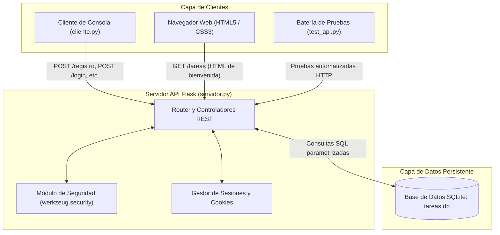

# PFO 2: Sistema de Gestión de Tareas con API y Base de Datos

**Materia:** Programación sobre Redes  
**Carrera:** Tecnicatura Superior en Desarrollo de Software (TSDS)  
**Alumno:** Guillermo Aybar  
**Año lectivo:** 2026  

---

## 🎯 Objetivos del Trabajo Práctico

1. **Implementar una API REST** con endpoints funcionales en Python utilizando **Flask**.
2. **Utilizar autenticación básica con protección de contraseñas**, aplicando técnicas de hashing criptográfico unidireccional con sal (*salt*).
3. **Gestionar datos persistentes con SQLite**, asegurando transaccionalidad ACID y relaciones entre entidades (usuarios y tareas).
4. **Construir un cliente en consola interactivo** que consuma los endpoints de la API mediante solicitudes HTTP.
5. **Generar la documentación técnica**, respuestas conceptuales, capturas de verificación y despliegue en **GitHub Pages**.

---

## 🏗️ Arquitectura y Flujo de Comunicación

El proyecto implementa la arquitectura **Cliente-Servidor** mediante el protocolo **HTTP/REST**:



### Especificación de Endpoints

| Método | Endpoint | Descripción | Parámetros / Body (JSON) | Código HTTP Éxito |
|---|---|---|---|---|
| **POST** | `/registro` | Registro de nuevo usuario (hasheando contraseña) | `{"usuario": "nombre", "contraseña": "1234"}` | `201 Created` |
| **POST** | `/login` | Autenticación y apertura de sesión | `{"usuario": "nombre", "contraseña": "1234"}` | `200 OK` |
| **GET** | `/tareas` | **HTML de Bienvenida** (Navegador) o lista de tareas en JSON | Formato negociado (`Accept: text/html` o `application/json`) | `200 OK` |
| **POST** | `/tareas` | Creación de nueva tarea vinculada al usuario | `{"titulo": "Estudiar Redes", "descripcion": "..."}` | `201 Created` |
| **PUT** | `/tareas/<id>` | Actualizar estado (marcar como completada) | `{"completada": true}` | `200 OK` |
| **DELETE** | `/tareas/<id>` | Eliminar una tarea por ID | *Ninguno (ID en URL)* | `200 OK` |
| **POST** | `/logout` | Cierre de sesión y limpieza de cookies | *Ninguno* | `200 OK` |

---

## 🧠 Respuestas Conceptuales Requeridas

### 1. ¿Por qué hashear contraseñas?

Almacenar contraseñas en texto plano es una de las vulnerabilidades más críticas en la seguridad informática. Las razones fundamentales para utilizar funciones de hash criptográfico son:

1. **Protección ante Brechas de Seguridad (Data Breaches):**
   Si un atacante vulnera el servidor o descarga una copia no autorizada de la base de datos (por ejemplo, mediante una inyección SQL o un volcado accidental de backups), al estar las contraseñas hasheadas **el atacante no puede leer las claves reales de los usuarios**. Como los usuarios frecuentemente reutilizan contraseñas en múltiples servicios (correos electrónicos, cuentas bancarias, redes sociales), el impacto de una filtración en texto plano sería devastador para su identidad digital.

2. **Propiedad Unidireccional (*One-Way Function*):**
   Una función hash criptográfica está diseñada matemáticamente para ser de un solo sentido. Es computacionalmente trivial calcular el hash $H = \text{hash}(P)$ a partir de una contraseña $P$, pero es **matemáticamente inviable** revertir el proceso para obtener $P$ a partir de $H$. A diferencia del cifrado simétrico o asimétrico (donde existe una clave de descifrado que puede ser interceptada o robada), en el hash no existe clave para "volver atrás".

3. **Autenticación sin Conocer el Secreto:**
   Para validar a un usuario durante el `/login`, el servidor **no necesita saber ni descifrar su contraseña**. Simplemente toma la contraseña que el usuario escribe en el formulario, le aplica la misma función de hash con la sal correspondiente y compara el hash resultante con el hash guardado en SQLite. Si ambos coinciden, la identidad queda demostrada.

4. **Mitigación de Tablas Arcoíris (*Rainbow Tables*) mediante Sal (*Salt*):**
   El sistema implementado en `servidor.py` (vía `werkzeug.security`) genera automáticamente un *salt* (cadena criptográficamente aleatoria) única para cada usuario antes de calcular el hash. Esto garantiza que si dos usuarios eligen la misma clave (ejemplo: `"1234"`), sus hashes en la base de datos serán completamente distintos, anulando los ataques basados en diccionarios precalculados.

5. **Ralentización Deliberada (*Key Stretching* / PBKDF2 / scrypt):**
   A diferencia de algoritmos de suma de comprobación rápidos como MD5 o SHA-1 (diseñados para velocidad y verificación de archivos, pero vulnerables a millones de intentos por segundo en GPUs), los algoritmos de hashing de contraseñas ejecutan miles de iteraciones de cálculo con consumo deliberado de memoria y CPU, haciendo inviable el ataque de fuerza bruta.

---

### 2. Ventajas de usar SQLite en este proyecto

Para este proyecto formativo, **SQLite** ofrece ventajas arquitectónicas sobresalientes frente a motores cliente-servidor tradicionales (como MySQL o PostgreSQL):

1. **Arquitectura Embebida y Sin Servidor (*Serverless / In-Process*):**
   SQLite no se ejecuta como un proceso daemon o servicio independiente en segundo plano, ni requiere escuchar en puertos de red de la máquina. La base de datos es una biblioteca que corre directamente embebida en el mismo proceso de la aplicación Flask (`import sqlite3`). Esto elimina problemas de configuración de red, conflictos de puertos y administración de servicios del sistema operativo.

2. **Cero Configuración (*Zero-Configuration / Portabilidad Total*):**
   Toda la base de datos (tablas, índices, disparadores y datos) se almacena en un **único archivo común en disco** (`tareas.db`). Esto hace que el proyecto sea 100% portable: clonar el repositorio y ejecutar `python servidor.py` es suficiente para tener la base de datos lista para operar, sin necesidad de crear esquemas previos, usuarios de base de datos ni configurar contraseñas de conexión.

3. **Persistencia Real frente a Soluciones en Memoria:**
   En los ejercicios iniciales de redes, la información se almacenaba en listas o diccionarios en memoria RAM (volátiles). Con SQLite, todos los registros de usuarios y tareas persisten de manera confiable en el almacenamiento secundario, manteniéndose intactos incluso si el servidor se detiene, se reinicia o se corta el suministro eléctrico.

4. **Cumplimiento Transaccional ACID (Atomicidad, Consistencia, Aislamiento y Durabilidad):**
   SQLite garantiza que todas las transacciones sean atómicas y consistentes mediante su mecanismo de *Rollback Journal* y *WAL* (Write-Ahead Logging). Si la aplicación sufre una caída en medio de una operación de escritura, la base de datos se recupera automáticamente sin corrupción ni estados intermedios inconsistentes.

5. **SQL Estándar y Fácil Escalabilidad Futura:**
   A pesar de su ligereza, SQLite soporta la sintaxis relacional SQL completa (`PRIMARY KEY`, `AUTOINCREMENT`, `UNIQUE`, `FOREIGN KEY`, `JOIN`, etc.). Si a futuro la aplicación creciera para soportar millones de solicitudes concurrentes y se decidiera migrar a un motor cliente-servidor robusto (como PostgreSQL), el código SQL requeriría mínimas adaptaciones.

6. **Rendimiento Excepcional en Operaciones Locales:**
   Al no incurrir en la latencia de ida y vuelta a través de la red (redirección por sockets TCP entre el servidor web y el motor de base de datos), el acceso a disco local en SQLite es sumamente veloz y eficiente para cargas medianas y de un solo servidor.

---

## 🚀 Guía de Instalación y Ejecución

### Requisitos Previos
- Python 3.10 o superior instalado.
- Administrador de paquetes `pip`.

### Paso 1: Instalar Dependencias
Abrir una terminal (PowerShell o CMD) en la carpeta del proyecto y ejecutar:
```bash
pip install -r requirements.txt
```

### Paso 2: Iniciar el Servidor API Flask
En la terminal principal:
```bash
python servidor.py
```
*Salida esperada:*
```text
[+] Base de datos SQLite ('tareas.db') inicializada correctamente.
=================================================================
  SERVIDOR API FLASK - GESTOR DE TAREAS (PFO 2)                 
  Escuchando en: http://127.0.0.1:5000                           
=================================================================
```

### Paso 3: Probar el Endpoint GET /tareas en el Navegador
Abrir cualquier navegador web e ingresar a:
👉 **[http://127.0.0.1:5000/tareas](http://127.0.0.1:5000/tareas)**

Se visualizará la página con el **HTML de bienvenida**, diseño responsivo oscuro y opciones de gestión.

### Paso 4: Ejecutar el Cliente Interactivo en Consola
En una **segunda terminal**, ejecutar:
```bash
python cliente.py
```
El cliente de consola ofrece un menú interactivo numerado del 1 al 9 para interactuar con la API de forma intuitiva:
1. Registrar nuevo usuario (`POST /registro`)
2. Iniciar sesión (`POST /login`)
3. Ver mis tareas (`GET /tareas` con formato JSON)
4. Agregar nueva tarea (`POST /tareas`)
5. Marcar tarea completada (`PUT /tareas/<id>`)
6. Eliminar tarea (`DELETE /tareas/<id>`)
7. Ver HTML de Bienvenida en Navegador
8. Cerrar sesión (`POST /logout`)
9. Salir

### Paso 5: Ejecutar la Batería de Pruebas Automatizadas
Para verificar el 100% de los endpoints y validar que las contraseñas se almacenen hasheadas en SQLite, ejecutar:
```bash
python test_api.py
```

---

## 📸 Capturas de Pantalla de Pruebas Exitosas

Las capturas de pantalla de evidencia se organizan dentro del directorio `capturas/`:

1. **`capturas/01_registro_y_login_cliente.png`**: Registro e inicio de sesión desde la consola con `cliente.py`.
2. **`capturas/02_contrasenas_hasheadas_sqlite.png`**: Inspección de la tabla `usuarios` en SQLite demostrando el almacenamiento del hash y la ausencia de texto plano.
3. **`capturas/03_html_bienvenida_navegador.png`**: Vista en el navegador web del endpoint `GET /tareas` mostrando el HTML de bienvenida.
4. **`capturas/04_gestion_tareas_consola.png`**: Creación, listado y modificación de tareas desde el cliente de consola.
5. **`capturas/05_bateria_pruebas_test_api.png`**: Ejecución completa y exitosa del script `test_api.py`.

---

## 🌐 Publicación en Repositorio GitHub y GitHub Pages

El proyecto incluye el archivo `index.html` especialmente preparado para ser alojado en **GitHub Pages**.

### Pasos para publicar:
1. Crear un nuevo repositorio en GitHub (por ejemplo, `PFO2-Redes-TSDS`).
2. Subir los archivos del proyecto al repositorio:
   ```bash
   git init
   git add .
   git commit -m "Entrega PFO 2 - Sistema de Gestion de Tareas con API y SQLite"
   git branch -M main
   git remote add origin https://github.com/TU_USUARIO/PFO2-Redes-TSDS.git
   git push -u origin main
   ```
3. Activar **GitHub Pages**:
   - En el repositorio de GitHub, ir a **Settings** > **Pages**.
   - En la sección **Build and deployment** / **Source**, seleccionar la rama `main` y la carpeta `/ (root)`.
   - Presionar **Save**.
4. En unos minutos, el sitio web estático estará disponible públicamente en:
   `https://TU_USUARIO.github.io/PFO2-Redes-TSDS/`

---

## 📁 Estructura del Proyecto

```text
PFO2_Guillermo_Aybar/
│
├── servidor.py             # Servidor API REST con Flask, SQLite y autenticación segura
├── cliente.py              # Cliente de consola interactivo (solicitudes HTTP con requests)
├── test_api.py             # Script de pruebas automatizadas y verificación de hashes
├── requirements.txt        # Dependencias del proyecto (Flask, requests, werkzeug)
├── index.html              # Landing page interactiva para GitHub Pages
├── README.md               # Documentación completa y respuestas conceptuales
│
└── capturas/               # Directorio para las capturas de pantalla de evidencia
    ├── 01_registro_y_login_cliente.png
    ├── 02_contrasenas_hasheadas_sqlite.png
    ├── 03_html_bienvenida_navegador.png
    ├── 04_gestion_tareas_consola.png
    └── 05_bateria_pruebas_test_api.png
```
